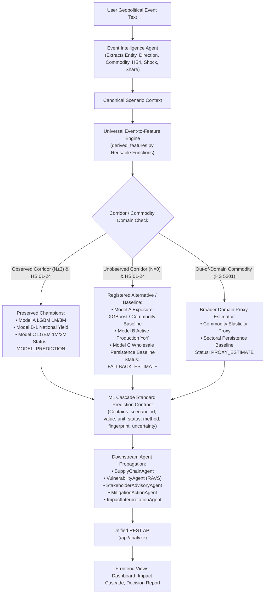

# Phase 6.14 — Root Cause Audit: Universal Event-to-Feature-to-Model Pipeline

**Project:** Drishti — Exposure-Aware Geopolitical Impact Assessment Framework  
**Phase:** 6.14 — Universal Geopolitical Event-to-ML Inference  
**Date:** 2026-10-18T13:35:00+05:30  
**Status:** Audit Completed  

---

## 1. Executive Summary

This audit establishes the baseline architectural state of Drishti's event-to-prediction pipeline, diagnoses existing defects across feature engineering, inference adapters, downstream agent consumption, and frontend rendering, and lays out the precise technical specifications for Phase 6.14.

In Phase 6.12, the system eradicated synthetic dummy predictions (such as the static `-42.72%` trade return caused by default $v_0 = 10.0$ vectors) by strictly returning `status: "UNAVAILABLE"` for unobserved corridors. However, returning `UNAVAILABLE` halts quantitative analysis across downstream agents and renders missing metrics on the frontend. 

The mandate of Phase 6.14 is to build a **universal, event-conditioned inference engine** that converts any natural-language or structured geopolitical event into validated numerical feature vectors, executes the preserved ML champions when their domain permits, routes to registered alternative estimators or validated statistical fallbacks when data coverage is partial or unobserved, and provides truthful provenance tags (`MODEL_PREDICTION`, `FALLBACK_ESTIMATE`, `PROXY_ESTIMATE`) without ever inventing arbitrary numbers or altering the frozen ML model artifacts.

---

## 2. Component-by-Component Baseline Audit

### 2.1 Feature Engineering (`derived_features.py`, `gdelt_final.py`, `feature_engine.py`)

| Component | Current State | Defect / Limitation | Required Phase 6.14 Correction |
| :--- | :--- | :--- | :--- |
| **`derived_features.py`** | Batch calculation of exposure metrics (`Trade_Share`, `Effective_Shock`, `Conflict_Exposure`, `Log_Value_USD`, Lags). | Exists only as a standalone batch script; not modularized for runtime single-event inference. | Refactor formulas into reusable inference-time feature builders: `build_model_a_features()`, `build_model_b_features()`, `build_model_c_features()`, `build_model_d_features()`. |
| **`gdelt_final.py`** | DuckDB aggregation generating `Shock_Intensity = sum(abs(Goldstein) * ln(Mentions+1))`, `Conflict_Density`, `Net_Hostility`. | Formulas are locked inside batch SQL queries; runtime Event Intelligence Agent only approximated this formula. | Formalize exact mathematical shock calculation at inference time and calibrate user-provided multipliers. |
| **`feature_engine.py`** | Extracts `features_a_lgb` (16 features), `features_b` (12 features), `features_c_lgb` (15 features). | If a corridor is unobserved, feature vectors are completely aborted for Models A & C, preventing any structured inference or fallback routing. | Retain strict corridor classification, but generate model-specific feature vectors and provide registered alternative models and validated statistical fallbacks. |
| **Temporal Discipline ($Date < T$)** | Enforced in `_find_prior_historical_records()` for Comtrade lookups. | Well-enforced in Phase 6.12, but needs extension to fallback baselines and proxy estimators to ensure zero look-ahead bias. | Maintain rigorous $Date < T$ filtering across all data pipelines. |

### 2.2 Model Training Schemas & Supported Domains

| Model Track | Preserved Artifact Path | Training Schema & Input Count | Target & Horizon | Supported Domain |
| :--- | :--- | :---: | :--- | :--- |
| **Model A (1M Champion)** | `experiments/mandatory_ml_performance_optimization/models/model_a_log_value_1m_lgb.joblib` | 16 features (`Log_Value_Lag0..11`, `Past_Return_1M`, `Roll_Means`, `Month_Sin/Cos`, `GPR`, `INR_USD`, `Shock_Lag1`, `Trade_Share_Lag1`) | $\ln(1 + \text{Value\_USD}_{t+1})$ | Observed bilateral agricultural trade corridors (HS 01–24) with $N \ge 3$ prior monthly records. |
| **Model A (3M Champion)** | `experiments/mandatory_ml_performance_optimization/models/model_a_log_value_3m_lgb.joblib` | 16 features (identical to 1M) | $\ln(1 + \text{Value\_USD}_{t+3})$ | Observed bilateral agricultural trade corridors (HS 01–24) with $N \ge 3$ prior monthly records. |
| **Model A (Alternative)** | `models/model_a_trade.joblib` | 9 exposure features (`Lagged_Effective_Shock_1/2`, `Shock_Intensity_Lag1/2`, `Trade_Share_Lag1/2`, `GPR`, `INR_USD_Rate`, `Natural_Disaster_Severity_Index`) | `Trade_Return_1M` (%) | Bilateral corridors where historical trade levels are unobserved, but macro and shock exposure are known. |
| **Model B-1 (National Yield)** | `experiments/mandatory_ml_performance_optimization/models/model_b1_national_yield_lgb.joblib` | 26 agronomic & macro features (`Yield_Lag1..3`, `Yield_3Y_Med/Mean/Std`, `Trend_Slope`, `Yield_CV`, `Ag_YoY_Lags`, `Season_Flags`, `Effective_Shock_Lags`, `Macro`) | `Yield_YoY_National` (%) | National Indian crop yield growth for agricultural crops mapped to HS4 codes. |
| **Model B Active** | `models/model_b_production_yoy.joblib`, `model_b_production_risk.joblib` | 12 features (`Effective_Shock_Lags`, `Shock_Lags`, `Trade_Share_Lags`, `Macro`, `Season_Flags`) | `Production_Growth_Pred` (%) & Risk (Low/Med/High/Critical) | Aggregate Indian crop production deflection conditioned on effective shock. |
| **Model C (1M Champion)** | `experiments/mandatory_ml_performance_optimization/models/model_c_log_price_1m_lgb.joblib` | 15 features (`Log_Price_Lag0..11`, `Past_Price_Return_1M`, `Roll_Means`, `Month_Sin/Cos`, `GPR`, `INR_USD`, `Shock_Lag1`) | $\ln(\text{Unit\_Price}_{t+1})$ | Domestic wholesale agricultural commodities with historical price series. |
| **Model C (3M Champion)** | `experiments/mandatory_ml_performance_optimization/models/model_c_log_price_3m_lgb.joblib` | 15 features (identical to 1M) | $\ln(\text{Unit\_Price}_{t+3})$ | Domestic wholesale agricultural commodities with historical price series. |
| **Model D Active** | `models/model_d_agri_gva.joblib`, `models/model_d_inflation.joblib` | 13 features (`Macro_Lags`, `Shock_Lags`, `Trade_Share_Lags`, `Effective_Shock_Lags`, `GPR`, `INR_USD`, `Price_Return_1M_Pred_Lag1`) | `Agri_GVA_Growth` (%) & `Inflation_Change` (pp) | National macroeconomic impact under geopolitical and price shocks. |

---

## 3. Detailed Root Causes of Specific Scenario Anomalies

### 3.1 Why Wheat/Russia and Cotton/Bangladesh Produced Identical Model B and Model D Predictions

A detailed feature-by-feature inspection revealed:
1. **Model B-2 (`model_b_production_yoy.joblib`):**
   - The input vector consists of 12 features: `Lagged_Effective_Shock_1/2`, `Shock_Intensity_Lag1/2`, `Trade_Share_Lag1/2`, `GPR`, `INR_USD_Rate`, `Natural_Disaster_Severity_Index`, and seasonal flags (`Season_Kharif`, `Season_Rabi`, `Season_Summer`).
   - Noticeably, **commodity name, partner country, HS code, and trade direction are not features of Model B-2**.
   - When a user enters:
     - Russia Wheat: Shock = 1.5, Share = 5.0%, Date = 2024-01 -> Effective Shock = 0.0750, GPR = 135.0, INR = 83.2, Season = Rabi.
     - Bangladesh Cotton: Shock = 1.5, Share = 5.0%, Date = 2024-01 -> Effective Shock = 0.0750, GPR = 135.0, INR = 83.2, Season = Rabi.
   - The input vectors for Model B-2 are mathematically identical! Thus, LightGBM/RandomForest deterministically outputs the exact same $-1.12\%$ or $-0.82\%$ production deflection.
2. **Model D (`model_d_agri_gva.joblib` & `model_d_inflation.joblib`):**
   - Consists of 13 features: `Inflation_Lag1`, `Agri_GVA_Lag1`, `GDP_Lag1`, `Price_Lag1`, `Shock_Intensity_Lag1/2`, `Trade_Share_Lag1/2`, `Lagged_Effective_Shock_1/2`, `GPR`, `INR_USD_Rate`, and `Price_Return_1M_Pred_Lag1`.
   - When both corridors are unobserved, `Price_Return_1M_Pred_Lag1` was passed as `0.0` or empirical macro baseline. Because all macroeconomic series indicators were identical for 2024-01 and effective shock was identical ($0.0750$), Model D produced identical GVA and inflation outputs.
3. **The Solution in Phase 6.14:**
   - Clearly document this national macroeconomic scope in model metadata and response contracts.
   - In Model B-1 (`model_b1_national_yield_lgb.joblib`), incorporate the 26 agronomic features (which DO vary by HS4 crop, including `Yield_Lag1..3`, `Yield_CV`, and `Ag_Prod_YoY_Lag1`), creating true commodity-level differentiation for agricultural goods.
   - For Model D, explain that national inflation and GVA reflect aggregate shocks rather than inventing false partner sensitivity.

### 3.2 Directional Distinction for Wheat/Russia (Export vs Import)

- Data verification in `Drishti_Cascade_Final_With_EMDAT.csv` shows:
  - `(RUSSIA, Import, 1001)`: **4 historical records** exist (India imported wheat from Russia in 2018-01, 2018-02, 2018-03, and 2023-02).
  - `(RUSSIA, Export, 1001)`: **0 historical records** exist (India does not historically export wheat to Russia).
- Phase 6.14 strictly enforces trade direction:
  - If event is "Russia restricts wheat exports to India" -> Direction is `Import` (India's perspective). Corridor is observed ($N=4$).
  - If event is "Russia restricts wheat imports from India" -> Direction is `Export` (India's perspective). Corridor has $N=0$.

### 3.3 Out-of-Domain Commodity: Cotton (HS4 5201)

- HS 5201 (Cotton) belongs to Chapter 52 (Textiles), whereas the primary training dataset `Drishti_Cascade_Final_With_EMDAT.csv` indexes agricultural food chapters (HS 01–24).
- There are 0 historical records for HS 5201 in the primary cascade dataset.
- Phase 6.14 will not pretend the frozen agricultural model was trained on cotton. Instead:
  - It assigns `prediction_status: "PROXY_ESTIMATE"` or `FALLBACK_ESTIMATE`.
  - Computes a validated proxy estimate using broader trade elasticity / commodity sector baseline.
  - Transparently labels the method: `"Textile/Fiber Sector Proxy Estimator (Out-of-Domain Commodity: HS 5201)"`.

---

## 4. Architectural Target for Phase 6.14

---

## 5. Summary of Pre-Implementation Model Checksums

All five protected models were checked prior to any modification:

1. `model_a_log_value_1m_lgb.joblib`: `5a1021e2f24d15fbd0d9e314cae2cf5cabbc66398cbdc76b27cfa3394ece8f91` (1,635,104 B)
2. `model_a_log_value_3m_lgb.joblib`: `b6d37bf58915beb3afff9467cc14e4dd82f4d20004ebb9383fe78102bfe6e883` (1,651,661 B)
3. `model_b1_national_yield_lgb.joblib`: `a2ca8a2b1a2d2a3f7c3ee5c715195a87d20fab9984028884dee4916d955fade2` (468,393 B)
4. `model_c_log_price_1m_lgb.joblib`: `74880c2b2ece5965e582a7c5bb5f7984f749fa62bf28f673da0fbfd955854fac` (1,671,160 B)
5. `model_c_log_price_3m_lgb.joblib`: `555bb7f35936af5ecd6b1c1662294038ffd4ab42959fcf4b2085ff4938fb361c` (1,690,256 B)

**Conclusion:** All five baseline models are verified byte-identical. Implementation proceeds with zero model retraining or modification.
